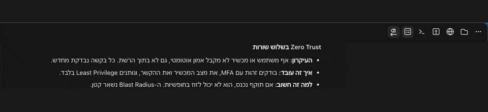

# claude-desktop-rtl

Right-to-left Hebrew and Arabic for the Claude desktop app on macOS.




In the Code tab, a Hebrew message with English words in it comes out scrambled, and Hebrew lines sit on the left. This tool patches the app so each paragraph gets its own text direction. It adds an icon button to the title bar and a Hebrew menu to turn it on and off. It keeps your original app, so you can undo it.

This is an unofficial project. Anthropic did not make it and does not support it. Read [Security and trust](#security-and-trust) before you install.

## Install

You need a Mac, the Claude desktop app in `/Applications`, and Python 3.9 or newer. Python is already there if you have the Xcode command line tools.

### From inside Claude, as a plugin

```
/plugin install rtl-hebrew --marketplace danan000/claude-desktop-rtl
```

In the desktop app, `/plugin` does not run. Click **+** next to the prompt box, then **Plugins**, then **Add marketplace** with `danan000/claude-desktop-rtl`, then **Add plugin**.

Start a new session and type `/rtl`. It shows the status. Then type `/rtl install yes`. Claude closes, patches itself and opens again in about 2 minutes. Your sessions stay. Unsent drafts may be lost.

The plugin changes nothing by itself. It runs the same `rtl.py` as the steps below. When a Claude update removes the patch, a toast tells you, and `/rtl install yes` puts it back.

### From Terminal

Quit Claude with Cmd+Q first. Run this in Terminal.app, not inside Claude.

```bash
git clone https://github.com/danan000/claude-desktop-rtl.git
cd claude-desktop-rtl
python3 rtl.py install --in-place
```

The install takes about a minute. It builds a patched copy, starts it once for 10 seconds with an empty profile to check that it runs, then puts it where the original was. Your original goes to `~/Library/Application Support/Claude-RTL/Claude.original.app`. It also adds a small background job that puts the patch back after Claude updates itself.

Then open Claude as always. macOS asks for access to "Claude Safe Storage". Read the prompt and click Allow. This happens because the patched app has a different signature from the original.

No Python packages and no Node are needed. You can also download the ZIP from GitHub instead of cloning.

Prefer to leave `/Applications/Claude.app` alone? Run `python3 rtl.py install` without `--in-place`. That makes a separate copy, `~/Applications/Claude-RTL.app`. Start it with `open -n ~/Applications/Claude-RTL.app`, and keep the original closed, because both share one data folder.

## Use

- **The button.** An RTL icon sits at the left end of the button row in the top right of the window. It looks and behaves like the buttons next to it. Click it to turn Hebrew layout on. Click again to turn it off. Hover for a label that says which state it is in.
- **The menu.** The macOS menu bar has a **Hebrew** menu, to the right of Help, with one checkbox. It is the same setting as the button.
- **What it changes.** Paragraphs, list items and headings in the chat where most words are Hebrew or Arabic. Code blocks, the composer and English text stay as they are. A line that opens in Hebrew counts as Hebrew when a third of its words are.

The setting is saved in `~/Library/Application Support/Claude-RTL/state.json`. To keep it somewhere else, for example in a dotfiles repo, add `--state-file PATH` to `install`.

### Try it

With the button on, send Claude this line:

```
בדקתי את הקובץ README.md ב-GitHub, והכל עובד
```

Claude's reply now sits on the right. The English words keep their order. With the button off, the same line sits on the left and the words jump around.

## Commands

| You type | What it does |
|---|---|
| `/rtl` | Shows whether the patch is active |
| `/rtl install yes` | Closes Claude, patches it and opens it again (about 2 minutes) |
| `/rtl uninstall yes` | Closes Claude, puts your original app back and opens it again |
| `python3 rtl.py status` | Same as `/rtl`, from Terminal |
| `python3 rtl.py install --in-place` | Patches `/Applications/Claude.app` (Claude must be closed) |
| `python3 rtl.py repair` | Puts the patch back after a Claude update |
| `python3 rtl.py uninstall` | Puts your original app back |

## After Claude updates

With `--in-place`, the background job checks every 10 minutes. After an update it waits until Claude is closed, then patches the new version. Open Claude again and the button is back. macOS asks about "Claude Safe Storage" once more: click **Always Allow**. A stable self-signed certificate would not prevent this prompt, because macOS ties the item to the binary's hash ([how it works](docs/how-it-works.md)). The job skips a version that fails the 10 second test, until the next update. Check by hand:

```bash
python3 rtl.py status
python3 rtl.py repair
```

With the separate copy, Claude updates `/Applications/Claude.app` and leaves the copy as it was. Run `python3 rtl.py status`, and rebuild with `python3 rtl.py update` when it says OLD.

## Uninstall

From inside Claude, type `/rtl uninstall yes`, then remove the plugin with `/plugin uninstall rtl-hebrew`.

From Terminal, quit Claude, then run:

```bash
python3 rtl.py uninstall
```

An in-place install puts the saved original back and removes the background job. A separate copy is deleted. Your state file stays until you delete it.

## Troubleshooting

| Problem | What to try |
|---|---|
| The icon is missing | The page may have renamed `.epitaxy-titlebar-end`. The Hebrew menu still works. Open an issue with your Claude version. |
| Hebrew is still on the left | Check that the button is pressed. With a separate copy, check that you opened `Claude-RTL.app`, not the original. |
| `open` starts the original app | Both apps share one bundle ID. Quit Claude first, then use `open -n`. |
| macOS asks about "Claude Safe Storage" again | Normal after each Claude update, because the repair builds a new binary. Click **Always Allow**. Never click Deny, and never delete that Keychain item: it holds the key to your Claude login. |
| The install stops with a list of problems | Fix each line it names and run it again. |
| `python3 rtl.py smoke` fails | It prints the FATAL line. The most likely cause is a Claude version that changed its integrity check. Open an issue. |

## Security and trust

The tool builds a patched copy, tests it, and only then swaps it in for your app. Your original stays in `~/Library/Application Support/Claude-RTL/`.

- **What it changes in the app.** It adds about 70 lines to the app's main process file and about 200 lines of page code. It rewrites two integrity values so the app accepts the edit, and it signs the app ad hoc.
- **What it does not do.** The patch makes no network calls. It does not touch your messages, cookies, keys or Keychain. The patch reads and writes one file, the state file. `tests/` fail if the page and app code mention `fetch`, `eval`, `child_process`, a network module, cookies or `safeStorage`.
- **What else it puts on your Mac.** The saved original, a copy of the tool in the same folder, a launch agent (`~/Library/LaunchAgents/com.danan000.claude-rtl.plist`) and the install log. `rtl.py uninstall` removes the agent and restores the original.
- **What you give up.** The patched app is not signed by Anthropic, so macOS does not vouch for it, and the Keychain prompt shows that. The hardened runtime and Anthropic's keychain group are gone.
- **Anthropic's terms.** Changing software can conflict with its terms of use. This tool changes a copy on your own Mac and ships none of Anthropic's code, but whether that is allowed is your call, not mine.
- **Read it.** `payload.js` runs in the page, `main-snippet.js` runs in the app, and `rtl.py` builds the copy. All three are short. [How it works](docs/how-it-works.md) explains the integrity check and why the build needs two edits.

## Windows

Not supported yet. The Windows app keeps its integrity data in a different place, and I have not seen a Windows install of Claude. If you use Windows, you can help. Run the probe. It only reads files and runs read-only Windows commands:

```
git clone https://github.com/danan000/claude-desktop-rtl.git
cd claude-desktop-rtl
py -3 probe_windows.py
```

The probe makes no change and uses no network. It writes `claude-rtl-probe.txt` in the same folder, with your user name replaced by `<user>`. Open an issue and paste the file.

## Limits

- macOS only for now. See [Windows](#windows).
- Tested on Claude 4.4212.0 (Electron 44.9.3) on Apple Silicon. Intel is untested.
- I have not tested a real Claude update on a patched app. The patched app is signed ad hoc, so Claude's updater may refuse an update. If it does, download Claude again from claude.ai/download and run `python3 rtl.py repair`.
- The swap, the restore and the repair logic have tests. I ran an in-place install on my own Mac and on a throwaway copy of the app, and an uninstall on the copy. Nobody has yet run `/rtl install yes`, the repair job after a real update, or an install on a second Mac.
- The code assumes the page keeps its current structure. A big redesign can break the button or the paragraph rule.

## Develop

```bash
node --test tests/*.test.js
python3 -m unittest discover -s tests
```

The tests need Node 20 or newer for the page and app code, and run the build checks against your installed Claude when there is one. The page code was also checked by hand on the real claude.ai page in Chrome, because a Node test cannot draw it.

The plugin tests run with `claude plugin test .` and `claude plugin validate .`.

For each release, raise `version` in `.claude-plugin/plugin.json`. An installed plugin updates only when that number changes.

## Help us test

This is an early release. If you try it, please open a [test report](https://github.com/danan000/claude-desktop-rtl/issues/new?template=test-report.yml). It asks for:

1. Your Claude version (Claude menu, then About) and your Mac (Apple Silicon or Intel).
2. If the install finished, and the last lines it printed. The install log is `~/Library/Logs/claude-rtl-install.log`.
3. If the RTL icon shows, and if Hebrew sits on the right.
4. Any error, with its exact text.

## License

MIT. See [LICENSE](LICENSE). "Claude" is a trademark of Anthropic. This project is not affiliated with Anthropic.
